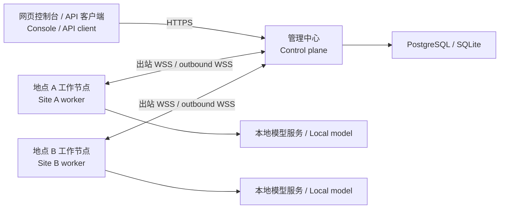

# 蜂群 · Edge Swarm

[简体中文](#简体中文) · [English](#english)

## 简体中文

蜂群把分布在不同地点的消费级 GPU 组织成一个大模型推理资源池。客户端访问统一的 OpenAI 兼容 API 或中文网页控制台。工作节点通过出站 WebSocket 连接管理中心，在各自设备上运行模型并回传结果。系统适用于由同一团队运营的一台管理中心和多台可信设备。

### 架构



| 组件 | 职责 |
| --- | --- |
| 管理中心 | 提供控制台和 API，按租户鉴权和排队，分配任务，持久化节点身份、执行租约、任务状态与结果。 |
| 工作节点 | 注册固定模型，探测本地后端的 `/v1/models`，上报连接、就绪和硬件信息，通过 WebSocket 接单并回传文本。默认每个 Agent 一个执行槽。 |
| 模型后端 | 每个地点独立运行 llama.cpp、vLLM 或兼容文本 SSE 的服务。GPU 驱动、显存、模型权重与上下文由该地点管理。 |
| 存储与入口 | 本地开发使用 SQLite。公网单中心部署使用 PostgreSQL，Caddy 或等效代理为客户端与工作节点提供 HTTPS。 |

### 核心功能

- **交互推理**支持同步文本聊天、SSE 流式输出、模型发现和取消。控制台提供推理工作台、任务记录、批组进度和设备管理。
- **异步批处理**支持单项任务和原子批组，可查询、取消和按幂等键提交。批组任一子项无效或容量不足时，整组拒绝。
- **调度与恢复**只在同模型、就绪、未排空的空闲节点之间选取。近期处理过相同租户和首条消息的节点优先，其余按最久未接单排序。中心检测到断线后，旧会话失去执行权，可重试批任务按退避策略转派。SQL 租约和执行代次隔离迟到的结果。已开始流式输出的交互请求中断时会明确失败。
- **节点运维与租户隔离**支持注册、排空、恢复和撤销设备，分别使用业务 API 密钥、管理员密钥与节点凭据。可用 `SWARM_MODEL_ACCESS` 限制各租户可调用的模型。公网工作端只需向中心发起出站连接，后端密钥留在设备上。
- **部署与诊断**支持 Windows x64 和 Linux x86_64 / ARM64。Linux 安装器通过 APT 或 DNF 补齐缺失的系统依赖，安装 systemd 服务并保留已有配置。Windows GPU 包可选自动修复 Microsoft VC++ x64 运行库。部署预检覆盖包校验、端口、数据库、中心 HTTPS 和后端模型。

### 快速开始

从源码构建需要 [Go 1.26 或更新版本](go.mod)。在 Windows PowerShell 中运行下列命令可用模拟后端验证完整传输链路，输出会明确标记为 `SIMULATED`。

```powershell
& .\scripts\smoke.ps1
```

在装有 Vulkan 驱动的 Windows x64 机器上，可下载固定版本的 llama.cpp 和 Qwen2.5 0.5B Instruct Q4_K_M，启动真实 GPU 推理。

```powershell
& .\scripts\install-local-gpu.ps1
& .\scripts\start-local.ps1 -LocalGpu
& .\scripts\local-credentials.ps1 -LocalGpu -Copy
```

打开 `http://127.0.0.1:18080/`，应用业务密钥并选择 `qwen-05b`。需要管理设备时，用 `local-credentials.ps1 -LocalGpu -Admin -Copy` 获取管理员密钥。执行 `& .\scripts\stop-local.ps1 -LocalGpu` 停止，数据库、凭据和日志会保留。 [Windows 安装包手册](docs/runbooks/windows-packages.md)

| 部署方式 | 入口 |
| --- | --- |
| 构建 Windows 管理端、工作端和离线 GPU 包 | 准备固定模型资源后运行 `powershell -NoProfile -File scripts/build-windows-packages.ps1 -IncludeGpu`。产物写入 `dist/windows/`。 |
| 构建 Linux 管理端和工作端包 | 在构建机用 PowerShell 7.4 或更新版本运行 `pwsh -File scripts/build-linux-packages.ps1`。产物写入 `dist/linux/`。 |
| Linux 预编译包 | 校验并解压对应架构的包，运行 `sudo bash ./swarm.sh install`。工作端首次安装后填写注册信息再运行一次。 [Linux 部署手册](docs/runbooks/linux-packages.md) |
| 公网部署 | 为中心配置 HTTPS、PostgreSQL 和域名，再从控制台注册工作节点。也可使用 `deploy/control/compose.yaml`。 [部署与运行手册](docs/runbooks/deployment.md) |

接入异地设备前，先在设备上启动模型后端。在中心按 `/v1/models` 返回的**精确模型名**注册，填写中心 HTTPS 地址、节点凭据和本地后端 URL。控制台显示节点「可接单」后即可提交该模型的请求。

### API 与运行约束

| 接口 | 用途 |
| --- | --- |
| `GET /` · `GET /healthz` · `GET /readyz` | 控制台、进程存活与数据库就绪 |
| `GET /v1/models` · `POST /v1/chat/completions` | 可用模型、同步或 SSE 聊天 |
| `POST /swarm/v1/batches` · `GET /swarm/v1/batches/{id}` | 异步单任务或原子批组提交、批组进度 |
| `GET /swarm/v1/jobs` · `GET /swarm/v1/requests` | 异步任务与交互请求列表，追加 `/{id}` 查询详情 |
| `POST /swarm/v1/{jobs,requests,batches}/{id}/cancel` | 幂等取消 |
| `GET /swarm/v1/nodes` · `POST /swarm/v1/nodes/enroll` | 管理员设备目录与注册 |
| `POST /swarm/v1/nodes/{id}/{drain,resume,revoke}` | 排空、恢复、撤销设备 |

业务接口使用 `Authorization: Bearer <业务密钥>`。聊天支持 `model`、文本 `messages`、`stream`、`max_tokens`、`temperature`、`top_p` 和 `stop`。使用 `{"items":[...]}` 提交原子批组，每组最多 20 项、1 MiB，每租户最多 20 项排队或运行任务。相同批组和 `Idempotency-Key` 返回原组，修改内容返回 HTTP 409。默认截止时间 120 秒，`X-Swarm-Deadline-Ms` 支持 100–600000 毫秒。可重试批任务最多执行三次，两次退避分别为 1 秒和 2 秒。

在 Windows 本地 GPU 启动后，用以下示例调用聊天接口。需要流式输出时，在请求体设置 `"stream": true` 并使用可读取 SSE 的客户端。

```powershell
$key = & .\scripts\local-credentials.ps1 -LocalGpu
Invoke-RestMethod 'http://127.0.0.1:18080/v1/chat/completions' `
  -Method Post -Headers @{ Authorization = "Bearer $key" } `
  -ContentType 'application/json' `
  -Body '{"model":"qwen-05b","messages":[{"role":"user","content":"Hello"}],"max_tokens":32}'
```

### 验证与边界

运行 `go test ./... -count=1` 执行 Go 测试。用专用测试数据库设置 `SWARM_TEST_POSTGRES_DSN` 和 `SWARM_TEST_E2E_POSTGRES_DSN` 后可测试 PostgreSQL 与 HTTPS/WSS。Windows RTX 5060 已用真实 Qwen 权重验证，llama.cpp 记录了 25/25 层 GPU 卸载。Linux 包已做归档校验及模拟安装，实际 systemd、软件源和跨地点负载需在目标环境验收。 [验收记录](docs/runbooks/acceptance.md)

当前版本聚焦单中心文本推理，节点会收到执行所需的明文输入。模型需要能在本地后端独立运行。跨公网模型分片、跨设备 KV 迁移、多中心自动接管、工具调用、图像输入、OpenAI 文件型 Batch、精确 token 用量和流式断点续写尚未实现。DeepInfer 路径目前提供固定版本硬件预检和离线参考入口，原生在线执行仍需在支持的硬件上验证。 [DeepInfer 接入](adapters/deepinfer/README.md) · [系统设计](docs/superpowers/specs/2026-11-07-edge-swarm-design.md)

## English

Edge Swarm pools consumer GPUs at multiple sites for large-model inference. Clients use a unified OpenAI-compatible API or the Chinese web console. Workers open outbound WebSocket connections to the control plane, run models on their own devices, and stream results back. The deployment model is one control plane and multiple trusted devices operated by the same team.

### Architecture

| Component | Responsibility |
| --- | --- |
| Control plane | Hosts the console and API, authenticates tenants, queues and schedules work, and persists node identities, execution leases, task state, and results. |
| Worker | Registers for one exact model ID, probes its local backend’s `/v1/models` endpoint, reports readiness and hardware metadata, and sends text results over WebSocket. Each agent has one execution slot by default. |
| Model backend | Runs llama.cpp, vLLM, or another text SSE-compatible engine independently at each site. GPU drivers, memory, model weights, and context limits are managed locally. |
| Storage and ingress | Uses SQLite for local development or PostgreSQL for a single public control plane. Caddy or an equivalent reverse proxy terminates HTTPS for clients and workers. |

### Features

- **Interactive inference** includes synchronous text chat, SSE streaming, model discovery, and cancellation. The web console offers a prompt workspace, task history, batch progress, and device management.
- **Durable asynchronous batches** support single jobs or atomic groups, status queries, cancellation, and idempotency keys. An invalid item or insufficient capacity rejects the whole group.
- **Scheduling and recovery** select an idle, ready, non-draining worker for the requested model. The scheduler prefers recent work with the same tenant and first message, then uses the longest-idle worker. A detected disconnect fences the old session so eligible batch jobs can be reassigned after backoff. SQL leases and execution fencing reject stale results. An interrupted chat stream fails explicitly once output has started.
- **Device operations and tenant access** include enrollment, drain, resume, and revocation. Client API keys, admin tokens, and node credentials are separate. `SWARM_MODEL_ACCESS` can restrict models per tenant. Public deployments only require workers to connect outbound, and backend API keys stay on their devices.
- **Deployment and diagnostics** cover Windows x64 and Linux x86_64 / ARM64. The Linux installer uses APT or DNF to fill missing system dependencies and install a systemd service while preserving existing configuration. The Windows GPU package can opt in to Microsoft VC++ x64 runtime repair. Preflight checks cover package integrity, ports, databases, control-plane HTTPS, and backend model IDs.

### Quick start

Building from source requires [Go 1.26 or newer](go.mod). Run the following from Windows PowerShell to exercise the transport end to end with a simulated backend. The response is marked `SIMULATED`.

```powershell
& .\scripts\smoke.ps1
```

On Windows x64 with a Vulkan-capable driver, download the pinned llama.cpp runtime and Qwen2.5 0.5B Instruct Q4_K_M weights and start real GPU inference.

```powershell
& .\scripts\install-local-gpu.ps1
& .\scripts\start-local.ps1 -LocalGpu
& .\scripts\local-credentials.ps1 -LocalGpu -Copy
```

Open `http://127.0.0.1:18080/`, paste the client API key in **业务密钥**, click **应用密钥** (Apply keys), and select `qwen-05b`. For device management, retrieve the admin token with `local-credentials.ps1 -LocalGpu -Admin -Copy` and paste it in **管理员密钥**. Stop with `& .\scripts\stop-local.ps1 -LocalGpu` to preserve the database, credentials, and logs. [Windows package guide](docs/runbooks/windows-packages.md)

| Deployment path | Entry point |
| --- | --- |
| Build Windows manager, worker, and offline GPU packages | Prepare the pinned GPU assets and run `powershell -NoProfile -File scripts/build-windows-packages.ps1 -IncludeGpu`. Archives are written to `dist/windows/`. |
| Build Linux manager and worker packages | Use PowerShell 7.4 or newer to run `pwsh -File scripts/build-linux-packages.ps1`. Archives are written to `dist/linux/`. |
| Install a prebuilt Linux package | Verify and extract the correct architecture, then run `sudo bash ./swarm.sh install`. For a new worker, fill in its enrollment configuration and rerun the installer. [Linux deployment guide](docs/runbooks/linux-packages.md) |
| Deploy over the internet | Configure a domain, HTTPS, and PostgreSQL for the control plane. Enroll each worker in the console. The repository also includes `deploy/control/compose.yaml`. [Operations guide](docs/runbooks/deployment.md) |

Start the model backend at each site before enrolling a worker. Register the **exact model ID** returned by `/v1/models`, then configure the control-plane HTTPS address, node credentials, and local backend URL. Submit a request for the model when its node status shows ready for work.

### API and operating limits

| Endpoint | Purpose |
| --- | --- |
| `GET /` · `GET /healthz` · `GET /readyz` | Console, liveness, and database readiness |
| `GET /v1/models` · `POST /v1/chat/completions` | Available models and synchronous or SSE chat |
| `POST /swarm/v1/batches` · `GET /swarm/v1/batches/{id}` | Submit an async job or atomic group and view group progress |
| `GET /swarm/v1/jobs` · `GET /swarm/v1/requests` | List async jobs and interactive requests, or append `/{id}` for details |
| `POST /swarm/v1/{jobs,requests,batches}/{id}/cancel` | Idempotent cancellation |
| `GET /swarm/v1/nodes` · `POST /swarm/v1/nodes/enroll` | Admin node directory and enrollment |
| `POST /swarm/v1/nodes/{id}/{drain,resume,revoke}` | Drain, resume, or revoke a node |

Client endpoints use `Authorization: Bearer <client-api-key>`. Chat supports `model`, text `messages`, `stream`, `max_tokens`, `temperature`, `top_p`, and `stop`. Submit an atomic batch group with `{"items":[...]}`. A group can contain up to 20 items and 1 MiB, and each tenant can have up to 20 queued or running tasks. Replaying a batch group with the same body and `Idempotency-Key` returns the original group. Changing the body returns HTTP 409. Deadlines default to 120 seconds and can be set between 100 and 600000 milliseconds with `X-Swarm-Deadline-Ms`. Eligible batch jobs have up to three attempts with 1-second and 2-second backoffs.

The [PowerShell request example](#api-与运行约束) above uses the local Windows GPU model. Set `"stream": true` in the request body to read the response with an SSE client.

### Validation and scope

Run `go test ./... -count=1` for the Go suite. Set `SWARM_TEST_POSTGRES_DSN` and `SWARM_TEST_E2E_POSTGRES_DSN` to dedicated test databases to cover PostgreSQL and HTTPS/WSS. Real Qwen inference on a Windows RTX 5060 recorded 25 of 25 layers offloaded by llama.cpp. Linux archives and installer fixtures have been checked. Target-host systemd setup, package repositories, and sustained multi-site load still require field validation. [Acceptance notes](docs/runbooks/acceptance.md)

This release focuses on single-center text inference. Workers receive the plaintext inputs needed for execution, and each model must run independently on its local backend. Cross-WAN model sharding, KV migration between devices, multi-center failover, tool calling, image inputs, OpenAI file-based Batch, exact token accounting, and resuming a partial stream are outside the current implementation. The DeepInfer path provides pinned hardware checks and an offline reference entry point. Native online execution still needs validation on supported hardware. [DeepInfer integration](adapters/deepinfer/README.md) · [System design](docs/superpowers/specs/2026-11-07-edge-swarm-design.md)
