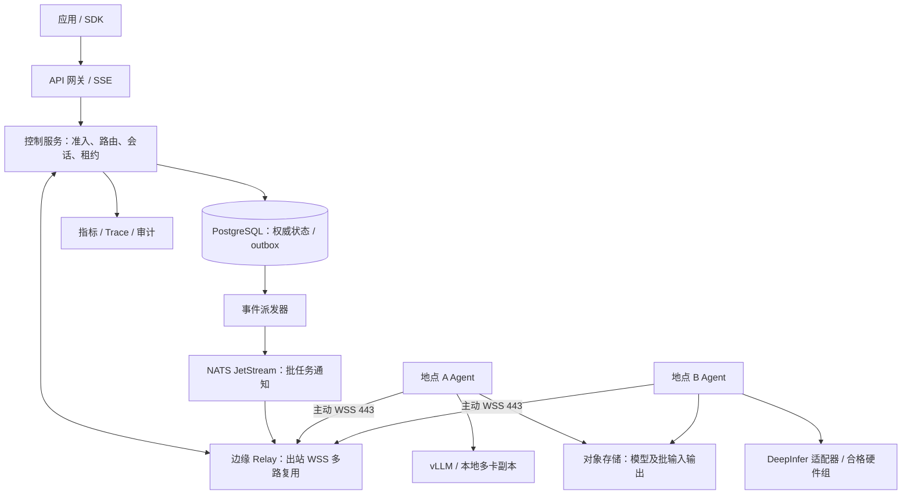

# 蜂群：公网异构 GPU 推理系统工程方案

版本：0.1，工程评审稿。日期：2026-11-07。

本文是一份可进入实现规划的系统设计，不代表已有软件、性能实测或生产可用承诺。用户已明确的条件是：消费级 GPU，分散在不同地点，通过公网连接；希望结合 DeepInfer 提升边缘设备效率。本文其余技术选择均为工程建议。

## 1. 决策摘要

采用“全局任务编排＋地点内推理”的分层架构。公网连接独立完整副本；一个副本可在地点内部使用多卡或多机并行。跨公网 TP、EP、逐层 PP 不进入首版关键路径。

消费卡首个正式后端选 vLLM，不能通过兼容性测试的设备可后续接 llama.cpp 本地服务；SGLang 为后续可选适配。DeepInfer 是独立插件及受控试验后端，不是消费卡必装依赖。没有符合其要求的硬件时，系统仍能交付消费卡推理池，DeepInfer 实机集成保持“未验证”。

最先交付两个工作流：固定模型的流式文本对话；可分块、可重试的离线文本生成。Embedding、重排按同一任务协议后续扩展。首版不执行用户上传的任意代码，不提供推理结果自动调用工具的执行环境。

核心优化目标是质量约束下、满足时限的有效完成量及每任务成本。GPU 利用率是诊断指标，不是优化目标。

### 1.1 路线比较

| 路线 | 选择 | 原因 |
|---|---|---|
| 深改 DeepInfer，统一所有设备 | 不选为首版 | 消费卡内核、模型覆盖、服务组件适配工作大 |
| 多后端＋统一边缘调度 | 采用，与上一轮建议一致 | 能先利用现有卡，兼容后续 DeepInfer 稳定资源组 |
| 公网全分片 P2P 模型 | 单独研究阶段 | 通信与状态恢复代价必须用实验证明 |

## 2. 假设、规模与边界

| 项目 | 首版设计假设 | 不满足时处理 |
|---|---|---|
| 节点规模 | 3—10 个试点地点、约 5—20 张卡；并非用户现有清单 | 扩容前按控制层与推理容量分别压测 |
| 操作系统 | 正式 worker 使用 Linux；Windows 经 WSL2 作为尽力支持试点 | GPU、容器、休眠恢复不合格的设备暂不进入正式池 |
| GPU | 首批以 NVIDIA 为主，不预设具体代际兼容 | 按型号、驱动、后端镜像建立白名单 |
| 模型 | 选可在至少一个地点独立容纳的开放权重文本模型 | 若所有地点均装不下，改小模型、集中卡或接外部容量；不能声称首版能靠公网聚合显存解决 |
| 数据 | 初期全部是同一组织管理或明确授权的可信节点 | 第三方出租卡须作为新的信任与计费阶段设计 |
| 网络 | 节点可以出站访问中心 HTTPS/WSS 443 | 不支持主动入站要求、UDP 打洞依赖或端口映射依赖 |
| 商业范围 | 内部试点，无资金结算 | 用量账本仅供归因，不称为计费可信凭据 |

容量验收采用实测而不是卡数。进入试点前生成锁定的 inventory、模型 revision、tokenizer、量化、镜像 digest、上下文、并发配置及测试集；缺任意一项不开展性能比较。

首版不包含：跨公网 GPU 统一内存、跨后端通用 KV 迁移、任意节点透明续写、全参数训练、自动降低模型质量、公共算力市场。

## 3. 架构与技术栈



| 部分 | 首版选择 | 约束 |
|---|---|---|
| API、控制服务、调度 | Go 单体模块化服务 | 分离 HTTP、状态机、评分、设备管理模块，先不拆微服务 |
| Edge Agent / Relay | Go；Agent 本地 SQLite WAL | GPU 遥测用 NVML 适配；容器管理用受控运行时接口 |
| 后端适配 | vLLM HTTP；DeepInfer 独立 Python 进程适配 | 业务协议不侵入后端，不能假定 DeepInfer 已有 HTTP 服务 |
| 权威数据 | PostgreSQL | 租约、幂等、结果提交均靠事务与条件更新 |
| 批事件 | NATS JetStream | 只携带事件 ID、任务 ID、版本；不放提示词和 token 流 |
| 模型和批文件 | S3 兼容对象存储 | 私有桶、短期下载授权、分块校验；不把数据库当文件系统 |
| 部署 | 中心和 worker Docker Compose；Agent systemd | 首版不依赖公网 Kubernetes 或跨公网 Ray 集群 |
| 可观测 | OpenTelemetry、Prometheus、Grafana | worker 经已有出站通道推送，公网不开放 metrics 端口 |
| 管理入口 | CLI＋受保护只读状态页 | 先支持注册、排空、撤销、模型部署、任务查询 |

实现时锁定全部版本与镜像摘要。上表是选型，不是已验证的版本兼容组合。中心先单区域部署，Relay 与数据平面分开扩容；到多区域时按地域分配任务归属，不跨公网同步选主。

## 4. 模块职责与最小契约

### 4.1 API 网关

鉴权、租户限流、输入大小检查、模型权限、幂等、流式回传。输入校验与模型聊天模板处理后才能准确核算 token；中心 tokenizer 必须与部署 revision 一致，禁止以字符数代替容量校验。

| API | 行为 |
|---|---|
| POST /v1/chat/completions | 首版支持 model、messages、stream、温度、top_p、max_tokens、stop；其余参数明确拒绝而非静默丢弃 |
| GET /v1/models | 只列出租户可访问的模型及明确别名 |
| POST /swarm/v1/batches | 提交对象引用及 manifest，返回 batch_id；缺省异步 202 |
| GET /swarm/v1/jobs/{id} | 返回状态、尝试次数、错误、结果引用 |
| POST /swarm/v1/jobs/{id}/cancel | 幂等取消；返回“取消请求已接收”而非承诺瞬时停止 |
| GET /swarm/v1/requests/{id} | 查询交互请求状态、attempt、是否开始输出及错误，不提供 SSE 历史重放 |
| POST /swarm/v1/requests/{id}/cancel | 幂等取消交互请求；进入取消中并透传到当前 attempt，完成后置 CANCELLED |
| POST /swarm/v1/nodes/enroll | 消耗一次性注册令牌，签发短期节点身份 |
| POST /swarm/v1/nodes/{id}/drain | 管理员或设备主人排空节点 |

项目扩展通过经过验证的请求头或 swarm 配置对象传递：deadline_ms、session_id、trust_policy、workload_class。session_id 不是授权凭据，每次请求仍检查 tenant_id。

交互请求在发送 HTTP 响应头前完成持久化，并在 X-Request-ID 响应头返回 request_id；首个 SSE 元数据事件也包含该 ID。requests 是交互 API 的权威实体，jobs 是批子任务实体，两者均拥有独立 attempt 归属且共享租约实现；attempt 只允许关联一种实体。查询和取消都校验 tenant，跨租户 ID 返回 404。非流式响应同样返回 X-Request-ID。

Idempotency-Key 在 tenant 范围唯一，绑定规范化请求 hash，24 小时有效。相同 key 不同 payload 返回 409；已经运行的重复请求返回 409 与 request_id，不创建第二次执行；已完成非流式请求可返回持久化结果。流式响应第一版不支持历史重放，明确返回已存在请求状态及查询入口。

### 4.2 模型目录与部署管理

ModelArtifact 身份由 model revision、权重文件哈希、tokenizer revision、聊天模板、量化及 adapter revision 联合确定；Deployment 另绑定后端版本、参数、GPU 集合及 KV 格式。

部署流程：兼容性筛选 → 磁盘预算 → 下载 → 文件 hash 校验 → 加载 → 固定样例探测 → 显存与时延校准 → READY。仅 READY 部署进入候选。失败有具体错误，不循环无限重拉。

### 4.3 地点控制器与设备 Agent

一个地点可有多个 Agent；一个 Deployment 由单一 Agent owner 负责容量账本。多机并行如需 Ray，只在地点隔离网络内运行，由当地部署模板管理。

Agent 上报：GPU 型号/UUID、可用显存、驱动、后端和模型状态、温度、功率、队列、活跃会话、网络 RTT/吞吐、主人工作时段。声明值与实测值区分；闲置未知设备不因自报高吞吐获得高优先级。

NVML GPU 占用反映其他应用竞争；发现显存被抢、温度越界或推理时延突变立即停止新准入，必要时取消最低优先级批任务。功率限制仅在设备主人授权及驱动支持时设置。

### 4.4 统一后端接口

```text
ProbeCapabilities() -> hardware/model/features/tokenizer/cache namespace
Prepare(artifact, deployment_spec) -> ready / failure
Estimate(request_shape) -> memory reservation, TTFT/decode estimate, confidence
Generate(request, attempt) -> accepted, delta*, usage, completed / failed
Cancel(attempt_id) -> acknowledged / unsupported
Drain(deadline) -> active attempts and predicted finish time
Health() -> ready, queue, capacity generation
```

首版能力集：text_generate、streaming、cancel、structured_output、prefix_cache、batch、kv_export。能力缺失必须向上报告；kv_export 默认 false，不能让适配器虚报缓存可迁移。只把模型/后端允许的参数透传给进程；用户不能提供命令行、任意宿主目录、任意下载 URL。

## 5. 公网连接与流式数据协议

Agent 主动连接 Relay 的 WSS 443，使用短期节点凭据和 TLS；支持的环境使用 mTLS，经过明确授权的 TLS 终止代理则使用轮转 token。首次注册令牌一次性、10 分钟有效；节点凭据建议 24 小时有效并提前轮转，撤销后关闭现存连接并拒绝续租。

多 Relay 采用数据库连接注册表 node_connections(node_id 主键、relay_id、connection_epoch、expires_at)。建立连接时在事务中递增 epoch 并取代旧 owner；Relay 每 5 秒续期，注册表 15 秒过期，条件更新必须匹配当前 owner/epoch。Relay 实例地址由内部服务发现提供，控制服务通过内部鉴权 RPC 将 OFFER/START 转交当前 owner；WSS 发送前再次匹配 epoch，Agent 拒绝旧 epoch 指令。注册表查询失败则暂停新任务。身份撤销、旧连接关闭不依赖注册表 TTL 才生效。

每个交互流记录 gateway_instance_id、relay_id、attempt_id 与 connection_epoch；token 经当前 Relay 的内部有界流式 RPC 返回原网关。新连接需先由控制层授权重新绑定原 attempt，保持 fencing token 不变，并且只在原网关存活、租约未过期且缓冲仍在时恢复；旧 epoch 帧拒收。网关死亡后不由其他实例重建该 SSE 流，标记中断。连接注册表只定位数据通道，不替代任务租约和结果提交权威。

单条连接多路复用控制和推理流，控制帧高优先级；必要时每节点分为控制与数据两条连接，避免大响应阻塞心跳。应用消息携带 protocol_version、node_id、connection_epoch、attempt_id、fencing_token、seq、type、payload。重连产生新 epoch，旧连接不能覆盖当前状态。

消息类型：HELLO、HEARTBEAT、OFFER、ACCEPT/REJECT、START、DELTA、RESULT、ACK、CANCEL、DRAIN。注册后协商最大帧 256 KiB；小段 token 按 20ms 或 4KiB 之一先到聚合，减少帧开销，用户看到的流式延迟计入此窗口。

每条流初始 1MiB 未确认字节窗口；连接总未确认预算 8MiB，按节点能力可降低。Relay 以 credit 控制发送，不能无限缓存；客户端变慢时后端能暂停则暂停，不能暂停则使用 2MiB/流有界缓冲，耗尽取消任务并报告 client_backpressure。断开后 Agent 最多保留 8MiB 聚合输出 15 秒；无法恢复时终止交互执行。

DELTA 用 attempt_id＋seq 去重。ACK 表示 Relay 收到，不能宣称用户已消费。仅同一 attempt、同一网关进程尚在且缓冲保留时允许内部重连重发；不承诺客户端断线后跨网关 SSE 重放。

模型文件、批输入输出走 HTTPS 对象存储，使用 Range 下载、短期授权及 manifest 校验。首版不做 UDP 打洞，也不把 broker 暴露给边缘设备。HTTP 代理阻断 WSS 的地点可后续接长轮询批任务，但不进入首版交互池。

## 6. 调度与准入算法

### 6.1 快慢两级调度

快速路由按请求执行：

1. 检查租户模型权限和 trust_policy；过滤不可访问地点。
2. 过滤模型身份、功能、上下文、READY、健康与工作时段。
3. 按 request shape 估算 KV、工作区和活跃 reservation，筛选容量。
4. 比较候选预计完成时间；会话亲和力只作为已存在缓存的节省，不绕过硬约束。
5. 控制层创建带版本的 OFFER；Agent 在本地容量锁内 ACCEPT 或 REJECT。
6. ACCEPT 后控制层事务提交有效 attempt 和租约，再下发 START；START 未提交不得运行。
7. Agent 启动前再次校验部署 generation、有效租约和 fencing token。

慢速放置每 5 分钟评估一次模型热度和供需，最短驻留 30 分钟；紧急安全事件可绕过驻留。迁移先预热新副本，再排空旧副本，绝不为腾显存直接卸载正在用的模型。

首版给交互池预留槽位，批任务只有不挤占交互容量时才领取。首版不在同一模型实例上混合不可控的长批任务和交互任务；没有足够资源就按时段切换，而非承诺无损抢占。

租户之间采用加权 deficit round-robin 选取待调度请求，初始费用单位为按 profile 预测的 GPU 毫秒；完成后记实际估算值用于校准，不允许单个租户无限占队列。每租户配置并发、输入/输出 token 预算、队列长度及权重；没有指定时试点默认并发 2、队列 20。交互在租户内部按 deadline 排序，批任务加入等待老化；批池饥饿超过 10 分钟告警，但不得突破交互容量硬预留。资源不足时如实显示排队，不保证无容量的任务也能按时完成。

### 6.2 可实现的初始评分

```text
estimated_time = relay_rtt + queue_wait
               + missing_input_tokens / measured_prefill_rate
               + expected_output_tokens / measured_decode_rate
               + input_bytes / measured_download_rate
               + expected_failure_probability * restart_cost
```

measured rate 使用模型＋后端＋上下文桶＋并发桶的 EWMA，取安全侧估计。decode_rate 为该并发下单请求速率，不把 GPU 总 token/s 当单请求速度。已有 batch 的排队时间以预计剩余工作估算，冷启动时间单独加入且交互缺省不选冷部署。

新设备先用固定短基准，随后小比例 canary；输出长度初始取 max_tokens 与同工作负载历史分位数的较小者，无历史取 max_tokens。仅对不足以达到请求时限的部署返回 queue/deadline 错误，不偷偷切换更小模型。

成本优化在满足时限的候选内进行：评分加入可配置的电费/传输/故障代价。成本权重和单位放配置中，通过离线回放校准，不把各单位直接相加。硬截止不能保证时，返回 429（短期容量不足，带 Retry-After）、503（无健康合格副本）或 422（模型/上下文不支持）；已接收任务超时转明确 deadline_exceeded。

### 6.3 显存与预留

每个部署离线探测输入长度、输出预留和并发矩阵。对标准注意力可以参考 KV 公式，但 MLA、压缩 KV、量化 KV 必须按后端测量，不能套统一公式。

Agent 是本机显存准入的最后权威，控制层估计只是预筛。reservation 按 deployment_generation 管理；OFFER 5 秒未接受过期；ACCEPT 后 10 秒未 START 自动释放，收到晚到 START 则拒绝。活跃 reservation 到终态或被本地看门狗停止后释放，不能仅因控制层失联就同时允许旧执行与新任务超卖。

## 7. 任务状态机、租约与幂等

```text
Request: QUEUED -> ASSIGNING -> RUNNING -> SUCCEEDED
                                      -> FAILED / INTERRUPTED / CANCELLED
Attempt: OFFERED -> ACCEPTED -> STARTED -> COMPLETED / FAILED / EXPIRED
Batch child: QUEUED -> RUNNING -> SUCCEEDED
                              -> RETRY_WAIT -> QUEUED
                              -> FAILED / CANCELLED
Node: ENROLLING -> PROBING -> READY -> DRAINING -> OFFLINE
                                -> QUARANTINED
```

执行语义是“至少一次计算、至多一次有效结果提交”；不宣称端到端恰好一次执行。NATS 提供通知和重投，数据库负责权威状态。每次尝试获取单调递增 fencing_token。任务结果表以 job_id 唯一约束，提交必须匹配当前 attempt/token 且租约有效；晚到旧结果只审计，不覆盖当前结果。

批任务：30 秒租约，10 秒续租，最长单子任务默认 120 秒；模型任务形状校准后可配置。Agent 续租只有在控制层事务确认后才有效。节点用单调时钟设置更保守的本地停止点；无法续租在本地停止点终止后端或所在隔离进程。即使进程未及时停止，fencing 也保证旧结果不能提交。

每个子任务最多 3 次尝试，总次数包括原始尝试；指数退避 5/15 秒并附随机抖动，受整体 deadline 约束。参数错误、模型不支持和确定性输入错误不重试；OOM 最多用更低并发重新规划一次，仍失败则终止，不能重复压垮节点。

提交批结果：先上传私有 attempt 临时对象并校验 → 数据库事务校验 token/租约并写 result_pointer、usage、terminal event/outbox → 返回提交确认 → broker ACK。相同有效提交重复返回既有结果；事务后 ACK 前崩溃的重投只查询终态。未引用的临时对象 24 小时后 GC。

数据库 outbox 同事务记录任务变更，事件派发至少一次；调度消费者按 event_id＋job_version 幂等。Broker 故障后由 outbox 重放，周期扫描 QUEUED、过期 OFFER 与租约任务作为补偿，不把 broker 消息当唯一任务记录。

### 7.1 流式交互的特殊规则

网关必须先以事务提交 output_started=true，再将第一段内容交给客户端传输栈。该标记表示“已经允许向外输出”，不等于客户端已读；事务后发送前崩溃可能造成保守中断，这是有意接受的代价。只有持有当前流所有权且仍存活的原网关可以触发自动重试，其他实例不能重建该流。output_started=false 时，只有在旧 attempt 已取消确认，或租约过期、旧 attempt 被 fencing 后，才允许最多一次自动重试；需仍满足 deadline。数据库不可写时不得发送尚未获得此标记的首段。

output_started 后故障：关闭该 attempt，发送可用的结构化错误事件并终止流；连接已坏则只能关闭并在状态查询中标记 INTERRUPTED。永不追加另一 attempt 的生成结果，不把不同采样输出拼成一条回答。用户显式重试创建新请求，保留 parent_request_id。

首版保持全局控制层依赖：中心不可达时不接受新的中心任务，已在执行的交互仅在数据连接和租约可维持时继续，批任务无法续租则停止。地点若需要独立离线 API，应使用独立命名空间，后续另行设计同步，不复用中心任务租约。

## 8. 核心数据模型

| 表 | 关键字段与约束 |
|---|---|
| nodes | id、site_id、owner、trust_group、identity_epoch、state、last_seen、policy_version |
| devices | node_id、gpu_uuid、hardware、driver、memory、health；node＋UUID 唯一 |
| artifacts | id、revision、manifest_hash、tokenizer_hash、quantization、license_record |
| deployments | id、artifact_id、backend_digest、config_hash、generation、owner_agent、capacity、state |
| capability_samples | deployment、shape_bucket、prefill/decode/energy、sample_count、updated_at |
| requests | id、tenant、idempotency_key、payload_hash、model_identity、deadline、status、output_started |
| attempts | id、request_id 或 job_id（二者恰一非空，数据库 CHECK 约束）、number、fencing_token、lease_expires、deployment_generation、state；各归属内 attempt number 唯一 |
| batches / jobs | batch_id、child_index、payload_ref、status、version、retry_count；batch＋index 唯一 |
| results | job_id 唯一、attempt_id、fencing_token、object_hash、object_ref、usage |
| session_affinity | tenant＋session、deployment、cache_namespace、last_seen；仅亲和力提示 |
| usage_events | request/attempt、input/output、cache_saved、energy_quality、wasted_compute |
| outbox / audit | event_id、entity_version、payload、published_at；不默认存提示词 |

请求正文加密存储与元数据分开：交互正文默认终态后 24 小时删除，可配置更短；批输入输出默认 7 天；审计与非正文用量默认 30 天。备份最长保留 7 天，删除策略覆盖备份到期；租户主动删除进入删除队列且停止相关缓存复用。日志禁止默认记录正文、凭据、完整签名 URL。

## 9. KV 与模型缓存策略

第一版只启用后端已支持的本地 prefix cache 和会话亲和力，不承诺可导出 KV。中心保存缓存 namespace 和近似命中信息，不保存或搬运张量。

namespace 包含 tenant、artifact、tokenizer、模板、LoRA、位置配置、KV dtype、backend build、并行布局。相同文本但 namespace 不同不能命中。跨租户共享仅限显式发布的公共前缀及后端可验证隔离能力，缺省关闭。

第二阶段同后端同 namespace 才试验内存/SSD 分级。收益判断：读取＋传输＋恢复耗时低于重新 prefill；过期、损坏、布局不匹配直接重算。对缓存目录加容量水位与 TTL，不能把全部 KV 无限落盘。

模型下载按 manifest 分块，断点续传、磁盘空间准入和 SHA 校验；使用不可变 revision。第一版中心对象分发；可信地点 P2P 分发作为后续开关，绝不在未校验时加载对端文件。数据流与模型下载限速分离，缺省下载占用不超过实测空闲带宽的 30%。

## 10. DeepInfer 集成工程

### 10.1 已核查的边界

官方 README 当前列出 DeepSeek-V4.1-Flash、NVIDIA SM100、Ascend 950，并说明完整 KV 缓存系统、VE/Prefill/Decode 分离以及 DP 副本负载均衡不包含在发布中。[S1]

不能由此推导 RTX 50 系列等消费卡兼容，也不能把其 benchmark 换算为公网消费卡性能。DSpark、bounded replay 等模型相关机制不得未经正确性证明直接移植到其他模型。

### 10.2 集成分四道门

| 门 | 工作 | 通过条件 | 失败处理 |
|---|---|---|---|
| D0 静态适配 | 固定 commit、构建依赖、梳理离线入口与 sampler、列出能力 | 可复现构建清单、明确模型/硬件要求 | 保持插件禁用 |
| D1 实机正确性 | 合格硬件离线基准，锁定 tokenizer、参数、模型 revision | 官方样例及本地回归集符合定义；无不明参数丢失 | 不进入任务池 |
| D2 服务封装 | 常驻 Python worker、队列、错误隔离、超时、取消 | 先非流式批任务；取消不支持时能按进程粒度隔离终止 | capabilities 中 streaming/cancel 明确 false |
| D3 在线资源组 | 流式 token 回调、准入、缓存边界、连续压测 | 满足相同 SLA 和故障测试才接交互 | 仅保留批服务 |

D2 以 DeepInfer 原生进程/并行组为生命周期单位，不能把一次超时用 kill 误伤其他租户；初期按租户/批次隔离进程池并计入冷启动。若后端取消会破坏并行组，整组排空重建，调度器暂停该组。D3 需确认后端可观察逐步输出并安全取消，无法验证则不对外声明流式支持。

不改 DeepInfer 内核即可开展的结合：统一 API 与模型权限、全局副本路由、地点资源预算、任务租约、模型分发和用量归因。进一步实现其缺失的 PD/KV 服务是独立里程碑，需在高速地点内先验证；跨后端通用 KV 不作为目标。

如果首批全是普通消费卡，D0 可以开展，D1—D3 因无合格硬件明确标注待验证；不能用 mock 测试替代实机 DeepInfer 集成验收。

## 11. 安全、可信执行与资源边界

同组织可信试点：节点只能读取分配给自己的任务，Agent 连接使用带身份的 TLS，管理员权限与设备权限分离，节点撤销立即停止接单。运行时服务只绑定 loopback 或地点隔离网络。

容器镜像固定 digest，非 root、移除无关 capabilities、只读根文件系统、任务临时卷配额、无 Docker socket 挂入推理容器。拥有宿主运行时控制权限的 Agent 属于高权限组件，其命令只接受签名/授权的部署模板。禁止用户提供任意镜像、挂载、模型远程代码；确需 remote code 的模型经独立审查后白名单发布。

出站对象请求限定允许的 endpoint/object key，防止任务引用变成 SSRF；证书撤销、镜像/模型更新及管理动作进入审计。控制层可看到解密请求，此方案不是端到端机密计算。

第三方节点无法仅靠 TLS 或容器保证输入保密，也无法仅靠心跳证明计算诚实。后续若开放市场，只分配明确允许的非敏感工作；抽样对照可发现部分错误但不能证明每次正确，也不能替代 TEE/可信执行设计。首版不开放该市场。

## 12. 运行参数、故障处理与运维

以下均是起始参数，需根据公网抖动实测调节，不是保证值。

| 参数 | 初始值 |
|---|---:|
| 心跳 | 5 秒 |
| 节点 SUSPECT / 不再分配 | 15 秒未收到心跳 |
| 节点 OFFLINE | 30 秒；不代替任务租约判定 |
| OFFER / START 等待 | 5 秒 / 10 秒 |
| 批任务租约 / 续租 | 30 秒 / 10 秒 |
| 交互执行租约 / 续租 | 30 秒 / 10 秒 |
| 排空默认宽限 | 120 秒，过期按任务类型终止 |
| 初始每部署并发 | 1，测出容量后再提升 |
| 调度评分数据过期 | 5 分钟，过期降级至保守 profile |

| 故障 | 检测与处理 | 可接受损失 |
|---|---|---|
| 设备掉线 | 停准入、租约过期、fencing 后重派批任务 | 交互可能中断；批任务有重复计算 |
| GPU OOM | 取消相关执行、降低容量、复测；限定重试 | 当前 attempt 失败，不无限重启 |
| 中心 DB 不可写 | 停新任务与续租，不靠内存发新租约 | 执行依租约超时停止 |
| NATS 暂不可用 | outbox 积压、扫描补偿；批通知恢复后重投 | 批排队增加；交互不依赖 broker |
| Relay 重启 | 客户端流可能中断；Agent 重连更新 epoch | 不声称恢复跨网关 SSE |
| 重复/乱序消息 | seq、generation、fencing 条件处理 | 不出现重复有效结果或旧输出混入 |
| 对象存储不可用 | 下载/批提交失败后限次重试 | 已加载交互在正文策略允许时继续 |
| 主人收回设备 | DRAIN，截止后 cancel/stop | 超时任务走对应中断/重试路径 |

原型可单中心主机部署，接受中心单点风险。正式内部试点推荐两台无状态应用/Relay、托管 PostgreSQL HA 与对象存储；采用 JetStream 时运行 3 副本流及同区域 3 节点 broker。数据服务升级前做恢复演练。

可观测指标：准入失败原因、排队、TTFT、逐 token 时延、deadline 达成、batch 完成/重试、OOM、模型加载、网络字节、缓存节省、取消延迟、租约冲突、outbox 年龄。按模型/配置/请求桶分层，节点 ID 不直接作为高基数公开 label。

GPU NVML 功率积分与整机墙插电耗分开记录；缺电表时标“GPU 估算”，不把它称为总能耗。日志和 trace 通过 request_id/attempt_id 关联，不带提示词。

## 13. 验证计划与验收条件

### 13.1 固定实验方法

最少 3 个真实公网地点，一组稳定节点、一组可退出节点；选已获授权且至少一个地点能独立运行的同一模型 artifact。每种策略锁定相同 revision、量化、采样、并发上限和输出 token 预算。

工作负载覆盖 1K/4K/16K 输入与 128/512 输出（模型不支持则在 manifest 中缩减并解释），单轮、重复前缀、多轮和短批混合。输出达到 EOS 的真实长度需保留，不能把 max_tokens 当实际生成量。

基线 B0 是同样部署、同样容量过滤后的轮询；B1 加最少剩余工作路由；B2 加会话亲和与缓存；B3 加慢速模型放置。缓存冷/热分别测试，固定到达流量重放，至少 3 轮并报告分位数、区间和失败率。公网实测与 tc/netem 注入 RTT 20/80/150ms、有限带宽、丢包分别标注，不混作真实网络样本。

主指标：deadline 内成功完成请求数/设备小时、每合格完成的能耗与成本；辅助指标包含 TTFT P50/P95、逐 token 时延 P95、交互完成率、浪费 GPU 秒、模型下载字节。任务输出质量按固定回归集比较，不因路由擅自换模型。

### 13.2 硬性正确性门槛

1. 在至少 1,000 个子任务和断网/重复消息/进程崩溃注入下，不丢已受理任务；最终每项明确成功或失败，无永久悬挂。
2. 同一 job 最多一个有效结果；事务前后崩溃、旧 attempt 晚到、ACK 丢失都通过。
3. 已开始输出的交互故障时不混入其他 attempt token；禁止用正常结束标记掩盖失败。
4. 撤销节点身份后不能领取新任务、续租或提交有效结果；租户之间不能查询任务/对象。
5. 同时 ACCEPT 竞争不会超出本地 reservation；压力下 OOM 触发降容，不形成重启风暴。
6. 模型不兼容、容量不足、DeepInfer 未就绪有明确返回，绝不伪装成功。
7. 72 小时稳定性试验无持续内存/磁盘增长、无失效租约永久占位，重启能从 DB/本地 WAL 恢复状态。

### 13.3 初始服务目标与收益门槛

以下是试点目标，只有基准确认可承载的模型/输入桶才宣布支持，达不到就降低准入容量或调整公开 SLA：

- 热模型、1K 输入/128 输出、许可负载范围内：TTFT P95 ≤ 3 秒；逐 token 时延 P95 ≤ 150ms；无故障场景交互完成率 ≥ 99%。
- 不含模型加载和 GPU 等待的控制层准入/路由耗时 P95 ≤ 100ms，中心到 Agent RTT 单列；不得把公网往返算作本地控制开销。
- 断网批任务在租约失效后 10 秒内重新进入可调度队列，实际重新开始取决于健康容量；恢复提交不重复记有效用量。
- 升级优化策略的候选门槛：相对 B0，合格完成量提高 ≥ 15%，或每完成成本降低 ≥ 10%，同时质量不退化、交互完成率不降低超过 0.5 个百分点、P95 延迟不恶化超过 5%。未通过则保留基线，不能宣称收益。

1,000 项故障试验和 72 小时运行只是试点门槛，不构成大规模可靠性统计证明。DeepInfer 无实机时，只验适配协议与故障模拟，报告必须标明缺失 D1—D3。

## 14. 分阶段交付、人员与预算

估算为 3 名有分布式系统/推理经验的全职工程师（控制/网络、Agent/部署、推理/性能），另有兼职测试运维；约 8—12 周完成受控内部试点。属于规划估算，硬件、模型或平台范围扩大需重新估算。

| 阶段 | 周次估算 | 可交付结果与退出条件 |
|---|---|---|
| P0 基础实测 | 第 1 周 | inventory、兼容矩阵、三地点网络 profile、模型容量报告；没有可运行完整副本则先调整资源 |
| P1 最小贯通 | 第 2—3 周 | 注册/撤销、出站 WSS、vLLM 固定部署、流式 API、显存准入；单地点到三地点联通 |
| P2 批任务可靠性 | 第 4—5 周 | SQL 状态机、outbox、租约、fencing、对象结果、重试/取消；故障正确性门槛通过 |
| P3 效率优化 | 第 6—7 周 | profile 路由、亲和力、模型预热/排空、资源预算，B0—B3 对照报告 |
| P4 内部试点 | 第 8—9 周 | 运维、权限、备份恢复、72 小时压测、发布回滚说明；公布支持的模型/请求桶 |
| P5 DeepInfer 专项 | 第 10—12 周，取决于硬件 | D0—D3 逐门报告；无合格硬件不阻塞消费卡交付，但保留未完成项 |

P5 只是接入验证预算，不包括消费卡内核移植或大规模 PD/KV 存储开发。Windows 原生支持、AMD/NPU 全覆盖、跨公网 PP、投机解码跨节点执行单列未来项目，不能塞进上述期限。

### 14.1 成本模型

```text
月成本 = 中心计算/数据库/消息/存储费用
       + 公网传输与出口费用
       + 各地点平均整机功率(kW) × 工作小时 × 当地电价
       + 设备折旧 + 运行维护
每有效任务成本 = 总成本 / 达到质量与时限的成功任务数
```

需要单列模型初始下发、更新、批输入输出与 relay token 流的双向字节，计费按实际云厂商口径核算，不能把文本流量小等同于整个系统带宽成本低。

热对话公网有效吞吐大致随完整副本扩展，无法根据总显存线性估算。第一版成本预算先填入试点实测，不引用未核价的云报价或承诺回本周期。

## 15. 建议仓库与交付物

```text
cmd/control/             中心 API、调度、状态机
cmd/relay/               公网出站连接和 token 转发
cmd/agent/               本地准入、容器、遥测、任务执行
internal/{scheduler,lease,identity,artifact,session,usage}/
adapters/vllm/           本地 HTTP 与能力映射
adapters/deepinfer/      常驻 Python worker、隔离、能力探测
api/{openapi,protocol}/  对外 API、帧 schema、兼容性测试
migrations/              权威状态与 outbox 数据库迁移
deploy/{control,worker}/ 固定镜像的 Compose 与运行说明
benchmarks/              流量 manifest、对照实验、故障注入
docs/runbooks/           注册、排空、撤销、恢复、回滚
```

这只是建议目录，没有创建实现代码。P0 先产出资源清单和锁定配置，P1 才开始产品实现。后续实现规划应把每个阶段拆成可运行的纵向任务，先证明公网流式贯通，再增加优化。

## 16. 关键风险与实现前输入

| 风险 | 应对 |
|---|---|
| 所有地点装不下目标模型 | 不启动错误路线；先更换模型、集中卡或增加可信容量 |
| DeepInfer 消费卡不兼容 | 保留独立适配，消费卡走 vLLM/其他合格后端 |
| 节点主人争用或频繁关机 | 降级为短批任务节点；保留稳定交互池 |
| RTT 与上行导致 tail latency 高 | 地域亲和、连接复用、提前准入拒绝；不跨公网张量同步 |
| 热缓存依赖某单点 | 明确会话可能重算，不把缓存当持久业务真相 |
| 调度优化复杂但无实际收益 | 固定基线逐项消融；无收益回退 |
| 第三方节点窃取或伪造数据 | 首版限制可信管理域；市场化作为独立安全工程 |

真正部署前需要收集：每地点 GPU/显存/驱动/系统/内存/SSD、在线时段、网络上行下行/RTT、目标模型和授权、上下文与并发、数据可信范围、电价及预算。它们改变配置和验收规模，不妨碍先完成本设计。

## 17. 资料与证据边界

核查日期为 2026-11-07。链接的 latest/main 会变；P0 必须固定当时 commit、release 和镜像，并保留兼容矩阵。第三方性能数字未作为本方案收益依据。

- [S1 DeepInfer 官方 README](https://github.com/deepseek-ai/DeepInfer)：模型/硬件支持、离线入口和开源发布缺失组件。
- [S2 DeepInfer 官方部署 Q&A](https://github.com/deepseek-ai/DeepInfer/blob/main/doc/inference_deployment_qa.md)：完整系统架构背景；不能把其高速资源域规模结果直接外推到边缘公网。
- [S3 vLLM 官方并行文档](https://docs.vllm.ai/en/latest/serving/parallelism_scaling/)：地点内单卡、多卡与多机并行部署路径；并非保证任何消费卡兼容。
- [S4 NATS JetStream Pull Consumers](https://docs.nats.io/learn/jetstream/pull-consumers)：拉取消费、确认与流控基础；应用结果唯一性仍由数据库协议实现。

除上述明确归属的事实外，协议、参数、架构、时间及验收目标均是本文提出的工程选择，未宣称已实现或经过真实 GPU 压测。
